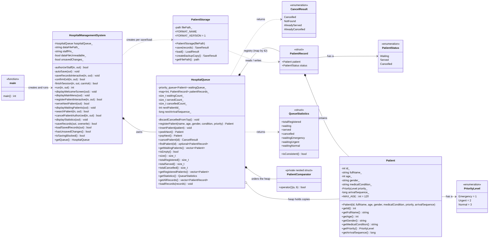
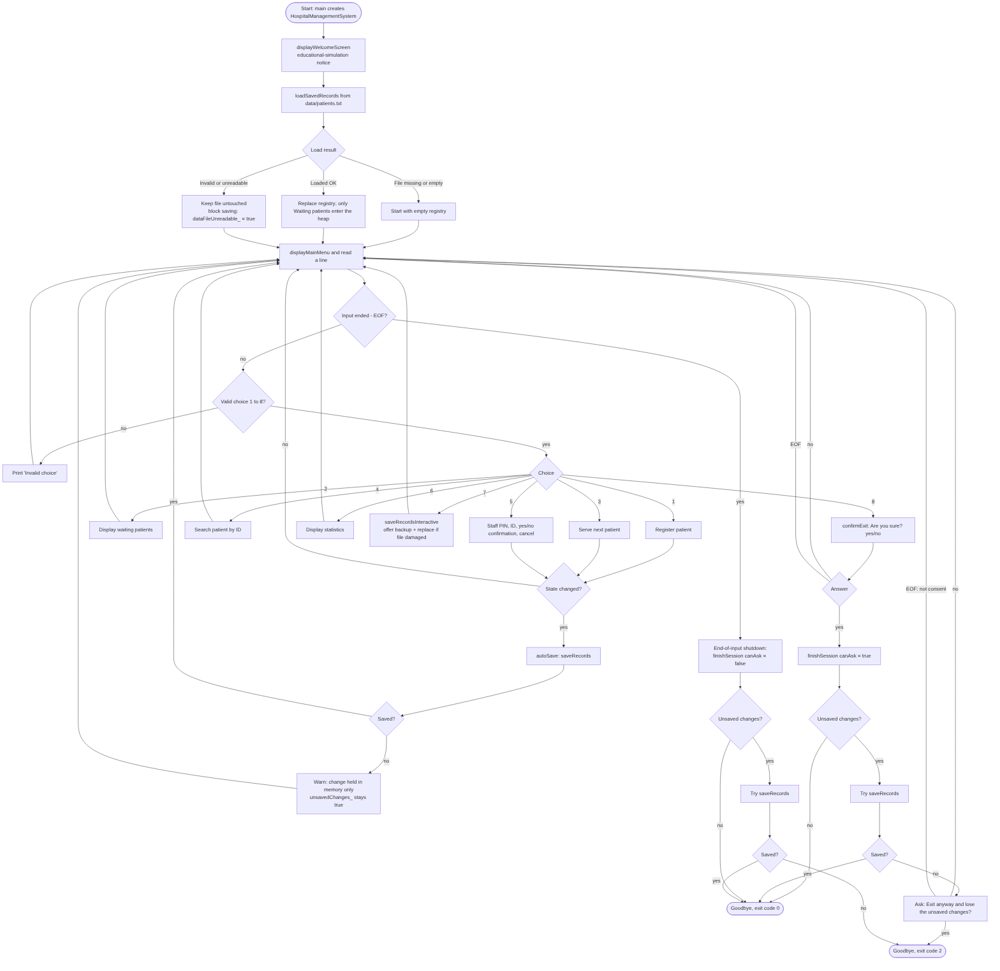
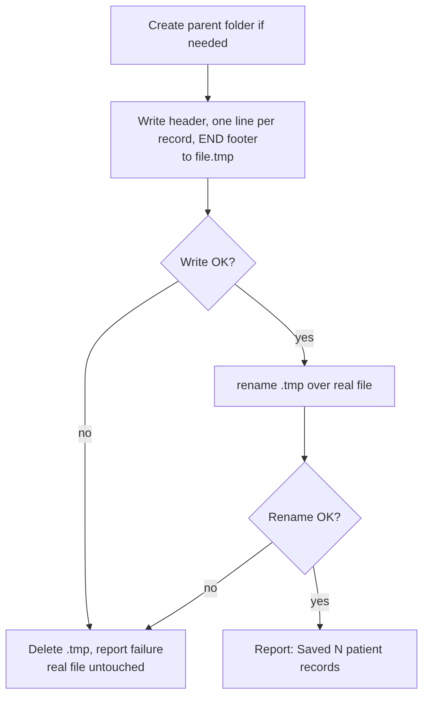
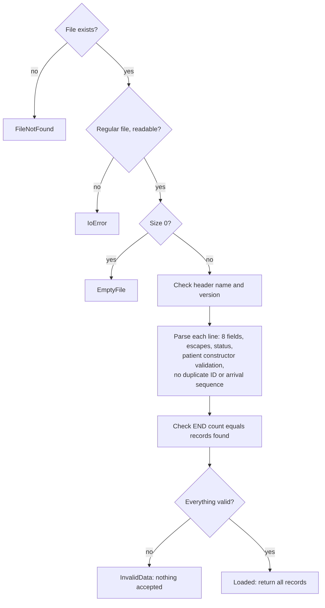

# Technical Documentation

**Hospital Queue Management System with a Priority Queue (C++17)**

> **Educational simulation.** This project is an educational queue-management
> simulation. It is **not** a clinically validated triage system. Real hospital
> triage requires approved medical protocols and qualified healthcare
> professionals.

Everything in this document describes the code that is actually in the project
folder. Where a statement refers to code, the file and function are named so
you can open it and check.

---

## 1. Source files at a glance

| File | Responsibility |
|---|---|
| `Patient.h / Patient.cpp` | The `Patient` value class, the `PriorityLevel` enum, `priorityToString`, `priorityFromInt`. |
| `HospitalQueue.h / HospitalQueue.cpp` | The priority queue, the patient registry, registration, serving, cancellation, search, statistics, record export/import. No console or file code. |
| `PatientStorage.h / PatientStorage.cpp` | Reading and writing the text data file; backup copy. No queue logic. |
| `HospitalManagementSystem.h / .cpp` | The user interface layer: welcome screen, menu loop, prompts, validation of typed input, staff PIN, confirmations, auto-save, shutdown rules. |
| `main.cpp` | Creates one `HospitalManagementSystem` and calls `run(std::cin, std::cout)`. |
| `tests/` | Seven test programs and a tiny shared helper (`test_framework.h`). |

The layering is deliberate:

```
main  ->  HospitalManagementSystem  ->  HospitalQueue  ->  Patient
                    |
                    +------------->  PatientStorage  ->  PatientRecord (from HospitalQueue.h)
```

`HospitalQueue` knows nothing about `std::cin`, `std::cout` or files, so it can
be tested in isolation. `HospitalManagementSystem` takes `std::istream&` and
`std::ostream&` instead of using `std::cin`/`std::cout` directly, so the whole
application can be driven by scripted input in a test.

---

## 2. Object-Oriented Programming concepts used

| Concept | Where it appears in this project |
|---|---|
| **Class and object** | `Patient`, `HospitalQueue`, `PatientStorage` and `HospitalManagementSystem` each model one concept. `main` creates one `HospitalManagementSystem` object. |
| **Encapsulation** | All data members are `private` (`Patient::id_`, `HospitalQueue::waitingQueue_`, `HospitalManagementSystem::unsavedChanges_`, ...). Outside code can only use public member functions. |
| **Constructors with validation** | The `Patient` constructor throws `std::invalid_argument` for an invalid ID, blank text, age outside 0-120, or non-positive arrival sequence. An invalid `Patient` object therefore cannot exist. |
| **Immutability** | `Patient` has getters only and no setters. A patient's priority or arrival sequence can never be changed after construction. Whether a patient is Waiting, Served or Cancelled is *not* stored in the `Patient`; it is stored beside it in `PatientRecord`. |
| **Separation of concerns** | Queue rules (`HospitalQueue`), file format (`PatientStorage`) and user interaction (`HospitalManagementSystem`) live in separate classes. |
| **Composition** | `HospitalManagementSystem` *owns* a `HospitalQueue` (member `hospitalQueue_`). `HospitalQueue` owns a `std::priority_queue` and a `std::map`. `PatientRecord` contains a `Patient`. |
| **Dependency** | `HospitalManagementSystem` creates a `PatientStorage` object whenever it saves or loads (it is not a member). `main` depends on `HospitalManagementSystem`. |
| **Enumerations (`enum class`)** | `PriorityLevel`, `PatientStatus`, `CancelResult`: named values instead of magic numbers, and no accidental conversion to `int`. |
| **const-correctness** | Getters and read-only operations are `const`; `findPatient` returns a *copy* in a `std::optional`, so callers cannot modify the registry. |
| **Exceptions** | Violations of a class's rules (`invalid_argument`, `out_of_range`) are reported by throwing. The UI layer catches `invalid_argument` and turns it into a message. |

Note on polymorphism and inheritance: **this project does not use inheritance
or virtual functions**, because the problem does not need them. Do not claim
otherwise in a presentation.

---

## 3. Classes and their responsibilities

### 3.1 `Patient` (Patient.h / Patient.cpp)

Holds one patient's identity and medical-priority data:

| Member | Meaning |
|---|---|
| `id_` | Unique patient ID (positive). |
| `fullName_`, `gender_`, `medicalCondition_` | Non-blank text. |
| `age_` | Whole number 0 to `MAX_AGE` (120). |
| `priority_` | `PriorityLevel`: `Emergency = 1`, `Urgent = 2`, `Normal = 3`. |
| `arrivalSequence_` | 1 for the first arrival, 2 for the next, and so on. Used for FIFO order. |

### 3.2 `HospitalQueue` (HospitalQueue.h / HospitalQueue.cpp)

Contains two data structures that are always kept in agreement:

| Member | Type | Purpose |
|---|---|---|
| `waitingQueue_` | `std::priority_queue<Patient, std::vector<Patient>, PatientComparator>` | Decides who is served next. |
| `patientRecords_` | `std::map<int, PatientRecord>` | The *registry*: every patient ever registered, found by ID, with their current status. |
| `waitingCount_`, `servedCount_`, `cancelledCount_` | `std::size_t` | Counters, so totals cost O(1). |
| `nextPatientId_`, `nextArrivalSequence_` | `int`, `long` | Generators for IDs and arrival sequences, both starting at 1. |

Public operations: `registerPatient`, `insertPatient`, `peekNext`, `popNext`,
`cancelPatient`, `findPatient`, `getWaitingPatients`, `isEmpty`, `size`,
`totalRegistered`, `totalServed`, `totalCancelled`, `getRegisteredPatients`,
`getStatistics`, `getAllRecords`, `loadRecords`.

### 3.3 `PatientStorage` (PatientStorage.h / PatientStorage.cpp)

Knows the file format and nothing else. `save(records)`, `load()` and
`createBackupCopy()` each return a result struct (`SaveResult`, `LoadResult`)
containing a success flag/status and a human-readable message. It never throws
for an expected problem such as a missing file.

### 3.4 `HospitalManagementSystem` (HospitalManagementSystem.h / .cpp)

The application layer. Public members include `run`, the individual menu
handlers (`registerPatientInteractive`, `serveNextPatient`,
`displayWaitingPatients`, `searchPatient`, `cancelPatientAuthorized`,
`displayStatistics`, `saveRecords`, `loadSavedRecords`) and the inspectors
`hasUnsavedChanges`, `isSavingBlocked`, `getQueue`. Two private flags carry the
persistence state:

* `unsavedChanges_` - memory differs from the data file.
* `dataFileUnreadable_` - the data file exists but could not be loaded; saving
  is blocked so the damaged file is not overwritten by accident.

Constants: `DEFAULT_DATA_FILE = "data/patients.txt"`, `DEFAULT_STAFF_PIN`,
`MAX_PIN_ATTEMPTS = 3`, `EXIT_OK = 0`, `EXIT_UNSAVED_CHANGES = 2`.

---

## 4. The priority queue and the custom comparator

`HospitalQueue` uses `std::priority_queue`, which is a **binary max-heap**: the
element the comparator ranks as "greatest" sits at the top. The comparator is
the private nested struct `HospitalQueue::PatientComparator`:

```cpp
struct PatientComparator {
    bool operator()(const Patient& a, const Patient& b) const {
        if (a.getPriority() != b.getPriority()) {
            return static_cast<int>(a.getPriority()) >
                   static_cast<int>(b.getPriority());
        }
        return a.getArrivalSequence() > b.getArrivalSequence();
    }
};
```

### How to read it

`std::priority_queue` calls `comp(a, b)` and, if it returns `true`, treats `a`
as *lower priority in the heap* than `b` (it must come out *later*). So the
comparator answers: **"should `a` be served after `b`?"**

1. If the two patients have **different priority levels**: `a` is served after
   `b` when `a`'s number is **larger**. `Normal (3)` is therefore served after
   `Urgent (2)`, which is served after `Emergency (1)`. This is why a *lower
   number means higher urgency*: the enum values were chosen as 1, 2, 3 to match
   the project specification ("Emergency (Priority 1)"), and the comparator
   inverts the usual "bigger is better" heap order.
2. If the priority levels are **equal**: `a` is served after `b` when `a`'s
   arrival sequence is **larger** (it arrived later). This is the FIFO rule.

### Why this keeps FIFO within a level

Arrival sequences are unique (section 5), so the pair
`(priority, arrivalSequence)` is a **total order** on patients: for any two
different patients the comparator gives a definite answer. A heap is not
generally stable, but here stability is not needed, because ties never occur;
the sequence number breaks every tie in favour of the earlier arrival.

### Worked example

Arrivals: `1:Normal`, `2:Urgent`, `3:Emergency`, `4:Normal`, `5:Urgent`,
`6:Emergency`, `7:Normal`.

Served order: `3, 6` (Emergency, FIFO) then `2, 5` (Urgent, FIFO) then
`1, 4, 7` (Normal, FIFO). This exact scenario is test A2 in
`tests/test_registration.cpp`.

### Why a priority queue instead of an ordinary queue?

An ordinary FIFO queue serves strictly by arrival time, so a critical patient
who arrives last would wait behind everyone. A priority queue always exposes the
most urgent waiting patient at its top in O(1), and inserting or removing costs
only O(log n). The alternative of keeping a sorted list would cost O(n) per
insertion.

---

## 5. ID and arrival-sequence generation

* `HospitalQueue` has two counters, `nextPatientId_` and `nextArrivalSequence_`,
  both initially 1.
* `registerPatient` builds a `Patient` using the *current* counter values and
  calls `insertPatient`. The counters move forward **only after** the patient
  has been inserted successfully.
* Consequently a failed registration (blank name, age 121, priority 4, ...)
  **consumes nothing**: the next valid patient still receives the next ID and
  sequence number. (Tests A4 and B4 in `test_registration.cpp`.)
* `insertPatient` sets each counter to `max(counter, value + 1)`. After records
  are loaded from a file, the counters continue after the highest ID and the
  highest arrival sequence that the file contained, so new patients never reuse
  old IDs, even those of served or cancelled patients.
* IDs and sequences are *separate* numbers. The ID identifies the patient; the
  sequence orders arrivals. In normal operation they happen to be equal, but the
  code never relies on that.

---

## 6. Status management and the registry

A patient's state is one of `PatientStatus::Waiting`, `Served`, `Cancelled`.
It is kept in the registry, not in the `Patient`:

```cpp
struct PatientRecord { Patient patient; PatientStatus status; };
std::map<int, PatientRecord> patientRecords_;   // key = patient ID
```

Transitions allowed by the code:

```
            registerPatient / insertPatient
                       |
                       v
                   [Waiting] --- popNext() ----------> [Served]
                       |
                       +--- cancelPatient() -----------> [Cancelled]
```

`Served` and `Cancelled` are final. `cancelPatient` returns
`AlreadyServed` or `AlreadyCancelled` instead of changing anything.

**Why a separate registry?**

* The heap can only efficiently expose its top element; it cannot look up a
  patient by ID. The `std::map` gives search by ID in O(log n).
* Served and cancelled patients are no longer in the heap, but the project
  requires that they remain searchable and countable, so the registry keeps
  them.
* It lets `insertPatient` reject a duplicate ID immediately (`map::emplace`
  fails when the key exists).

The class invariant that tests check after operations:
`waiting + served + cancelled == totalRegistered`
(`QueueStatistics::isConsistent()` also checks that the three priority counts
add up to `waiting`).

---

## 7. Cancellation and lazy deletion

`std::priority_queue` has **no operation to remove an arbitrary element**. To
cancel a waiting patient the code uses *lazy deletion*:

1. `cancelPatient(id)` looks the patient up in the registry (O(log n)). If the
   status is not `Waiting` it returns `NotFound` / `AlreadyServed` /
   `AlreadyCancelled`.
2. Otherwise it only changes the **registry status** to `Cancelled` and updates
   the counters. The patient's copy stays inside the heap as a *ghost* entry.
3. It then calls the private `discardCancelledFromTop()`.

**Class invariant:** *the top of the heap is always a genuine Waiting patient
(or the heap is empty).* `discardCancelledFromTop()` restores it: while the top
entry's registry status is not `Waiting`, pop it. It is called after every
`popNext()` and `cancelPatient()`. Because of the invariant:

* `peekNext()` is always correct and O(1).
* `popNext()` never serves a cancelled patient.

Ghost entries *below* the top are harmless: they are skipped by
`getWaitingPatients()` (which checks the registry) and are removed when they
eventually reach the top. Each ghost is popped at most once, so the cleaning
cost is **amortised** O(log n) per operation.

`isEmpty()` and `size()` use `waitingCount_`, not the heap size, because the
heap may still hold ghosts. (Test A7 in `test_serving_search_cancel.cpp` cancels
the front, a middle and the last patient and cancels everybody.)

**Authorization.** The UI layer (`cancelPatientAuthorized`) requires a staff PIN
(3 attempts) before the ID is even requested, refuses patients who are already
served or cancelled, shows the patient, and requires an explicit `yes`. The PIN
is a *classroom demonstration of access control*: it is a plain string in the
program, not real security. (The unauthenticated `cancelPatient` overload exists
for tests and is not reachable from the menu.)

---

## 8. Displaying the waiting list without destroying the queue

`std::priority_queue` cannot be iterated. `getWaitingPatients()` therefore
**copies the heap** (`auto copy = waitingQueue_;`), pops the copy until it is
empty, and keeps each patient whose registry status is `Waiting`. The patients
come out in exactly the order in which they will be served, and the real queue
is untouched. The same function gives the "position in queue" shown by Search.

---

## 9. Persistence: serialization and deserialization

### 9.1 File format (version 1)

`data/patients.txt` is plain text, tab-separated:

```
HQMS-PATIENT-RECORDS<TAB>1
<id><TAB><name><TAB><age><TAB><gender><TAB><condition><TAB><priority><TAB><arrival sequence><TAB><status>
... one line per patient, in ID order ...
END<TAB><number of patient lines>
```

* `status` is `Waiting`, `Served` or `Cancelled`.
* In text fields the characters backslash, tab, newline and carriage return are
  escaped as `\\`, `\t`, `\n`, `\r`, so a name can never break the line
  structure.
* The header carries a format name and version; the footer carries the record
  count so a truncated file is detected.

### 9.2 Saving (`PatientStorage::save`)

1. Create the parent folder (for example `data/`) if needed.
2. Write the whole content to `<file>.tmp`.
3. If writing succeeded, `rename` the temporary file over the real file (an
   atomic replace on common file systems). If anything fails, delete the
   temporary file and report the failure; the real file is untouched.

The program therefore never leaves a half-written data file, and it only claims
"Saved N patient record(s)" after the rename succeeded.

### 9.3 Loading (`PatientStorage::load`) - strict, all or nothing

`load()` returns one of five statuses: `Loaded`, `FileNotFound`, `EmptyFile`,
`InvalidData`, `IoError`. For a damaged file it checks the header name and
version, that every line has exactly 8 fields, that numbers parse completely
(`"30x"`, `"3.5"`, `" 5"`, overflow are rejected), that escapes are valid, that
the status is known, that the `Patient` constructor accepts the values, that
there is no duplicate ID or arrival sequence, that nothing follows the `END`
line, and that `END`'s count matches. A single problem rejects the **entire**
file; nothing is partially accepted. Windows line endings (CRLF) are tolerated.

### 9.4 Rebuilding the queue (`HospitalQueue::loadRecords`)

Builds a *new* `HospitalQueue`, then replaces the old state in one step, so a
failure leaves the existing registry unchanged. Only records with status
`Waiting` are pushed into the heap; `Served` and `Cancelled` records go only
into the registry. Because the comparator is deterministic, the restored heap
gives the same serving order as before the restart. ID/sequence counters
continue after the highest values found.

### 9.5 Damaged files are never silently overwritten

If startup loading reports `InvalidData` or `IoError`, `dataFileUnreadable_`
becomes `true`: automatic saves and manual saves are refused. Menu option 7
then offers to **replace** the damaged file; if the user answers `yes`, the
program first copies it to `<file>.bak` (`createBackupCopy`) and only then
writes the new file.

### 9.6 When saving happens

* automatically after each *successful* registration, serve or cancellation
  (never after a refused or failed action),
* when the user chooses option 7,
* when the user exits (outstanding changes are saved first).

If an automatic save fails, the patient/change stays in memory,
`unsavedChanges_` stays `true`, a clear warning is printed, and the program
never reports a save that did not happen.

---

## 10. Error handling and validation

| Layer | What is checked | How it is reported |
|---|---|---|
| `Patient` constructor | ID > 0, non-blank name/gender/condition, age 0-120, sequence > 0 | `std::invalid_argument` |
| `priorityFromInt` | value is 1, 2 or 3 | `std::invalid_argument` |
| `HospitalQueue::registerPatient` | trims text, then all of the above; validates before consuming ID/sequence | `std::invalid_argument` |
| `HospitalQueue::insertPatient` | duplicate patient ID | `std::invalid_argument` |
| `peekNext`, `popNext` | empty queue | `std::out_of_range` |
| `HospitalQueue::cancelPatient` | unknown / served / already cancelled | `CancelResult` value (not an exception) |
| `HospitalManagementSystem` prompts | blank text, non-numeric or out-of-range numbers, invalid menu choice, invalid ID | message and re-prompt |
| Confirmations | only `yes`/`y`/`no`/`n` (any letter case) | re-prompt on other text |
| `PatientStorage` | every I/O and format problem | `SaveResult` / `LoadResult` with a message, never an uncaught exception |
| End of input (Ctrl-D, closed pipe) | during any prompt | the action is cancelled; **end of input is never treated as consent** to cancel a patient or to discard unsaved changes |

Registration is **validate-then-commit**: all five fields are collected and
checked before the queue is touched, so cancelling halfway or entering invalid
data cannot leave a half-registered patient.

---

## 10a. UML class diagram



Source: `diagrams/class_diagram.mmd` (Mermaid). The diagram contains only the
classes, structs and enumerations that exist in the source code. `main` is
shown as a function. Relationships:

* `HospitalManagementSystem` **owns** one `HospitalQueue` (composition).
* `HospitalQueue` **contains** the registry of `PatientRecord`s and **holds
  copies** of `Patient` objects in its heap; `PatientComparator` is a private
  nested struct used by the heap.
* `PatientRecord` **contains** a `Patient` and a `PatientStatus`.
* `HospitalManagementSystem` **depends on** `PatientStorage` (a temporary
  object per save/load); `PatientStorage` reads and writes `PatientRecord`s.
* There is no inheritance in this project.

## 10b. System flowcharts

Startup, menu loop, auto-saving and shutdown:



Source: `diagrams/system_flowchart.mmd`.

Saving and loading a file:




Sources: `diagrams/save_flowchart.mmd`, `diagrams/load_flowchart.mmd`.

To re-render a diagram (Mermaid CLI): `mmdc -i diagrams/class_diagram.mmd -o diagrams/class_diagram.png -s 2 -b white`.

---

## 11. Pseudocode of the main algorithms

The pseudocode below mirrors the real functions; names are the real names.

### 11.1 Patient registration (`registerPatientInteractive` + `HospitalQueue::registerPatient`)

```
registerPatientInteractive(in, out):
    name      <- prompt until non-blank        (EOF -> print "cancelled", return false)
    age       <- prompt until integer 0..120   (EOF -> cancel)
    gender    <- prompt until non-blank
    condition <- prompt until non-blank
    priority  <- prompt until integer 1..3
    try:
        patient <- hospitalQueue.registerPatient(name, age, gender, condition, priority)
    catch invalid_argument as e:
        print "Registration failed: " + e.what ; return false
    unsavedChanges <- true
    print confirmation (ID, name, priority, arrival sequence)
    return true                                  # caller then runs autoSave

HospitalQueue::registerPatient(name, age, gender, condition, priorityValue):
    name, gender, condition <- trim each
    if any is empty: throw invalid_argument
    priority <- priorityFromInt(priorityValue)   # throws unless 1..3
    patient  <- Patient(nextPatientId_, name, age, gender, condition,
                        priority, nextArrivalSequence_)    # constructor validates
    insertPatient(patient)                       # counters advance only on success
    return patient

HospitalQueue::insertPatient(patient):
    if patientRecords_ already has patient.id: throw invalid_argument   # duplicate
    patientRecords_[patient.id] <- {patient, Waiting}
    waitingQueue_.push(patient)                  # heap sift-up, O(log n)
    waitingCount_++
    nextPatientId_       <- max(nextPatientId_, patient.id + 1)
    nextArrivalSequence_ <- max(nextArrivalSequence_, patient.arrivalSequence + 1)
```

### 11.2 Serving the next patient (`serveNextPatient` + `popNext`)

```
serveNextPatient(out):
    if hospitalQueue.isEmpty():                  # waitingCount_ == 0
        print "no patients waiting" ; return false
    patient <- hospitalQueue.popNext()
    unsavedChanges <- true
    print "NOW SERVING" and all patient details, status Served,
          and number of patients still waiting
    return true                                  # caller then runs autoSave

HospitalQueue::popNext():
    if heap empty: throw out_of_range
    next <- heap.top()                           # invariant: a genuine Waiting patient
    heap.pop()                                   # sift-down, O(log n)
    registry[next.id].status <- Served
    waitingCount_-- ; servedCount_++
    discardCancelledFromTop()
    return next
```

### 11.3 Cancellation with lazy deletion (`cancelPatientAuthorized` + `cancelPatient`)

```
cancelPatientAuthorized(in, out):
    if not authorizeStaff(in, out): return false     # up to 3 PIN attempts
    id <- prompt until positive integer              # EOF -> abort
    record <- hospitalQueue.findPatient(id)
    if none:                      print "No patient ... exists" ; return false
    if record.status = Served:    print "already been served"  ; return false
    if record.status = Cancelled: print "already cancelled"    ; return false
    show patient details
    answer <- askYesNo("Cancel this patient's registration?")
    if answer is not Yes (No or EOF): print "aborted" ; return false
    hospitalQueue.cancelPatient(id)
    unsavedChanges <- true
    return true                                      # caller then runs autoSave

HospitalQueue::cancelPatient(id):
    entry <- registry.find(id)
    if not found:                   return NotFound
    if entry.status = Served:       return AlreadyServed
    if entry.status = Cancelled:    return AlreadyCancelled
    entry.status <- Cancelled                        # heap copy becomes a "ghost"
    waitingCount_-- ; cancelledCount_++
    discardCancelledFromTop()
    return Cancelled

HospitalQueue::discardCancelledFromTop():
    while heap not empty:
        top <- heap.top()
        if registry[top.id].status = Waiting: return # invariant restored
        heap.pop()                                   # drop ghost
```

### 11.4 Saving (`PatientStorage::save`, called by `saveRecords`)

```
saveRecords(out, overwriteUnreadableFile):
    if dataFileUnreadable_ and not overwriteUnreadableFile:
        print "Save refused ..." ; return false
    result <- PatientStorage(path).save(hospitalQueue.getAllRecords())
    if not result.success: print error ; return false
    dataFileUnreadable_ <- false
    unsavedChanges_     <- false
    print result.message ; return true

PatientStorage::save(records):
    create parent folder if missing            (failure -> report)
    write to "<file>.tmp":
        "HQMS-PATIENT-RECORDS", TAB, version
        for each record: 8 escaped, tab-separated fields
        "END", TAB, number of records
    if the write failed: delete .tmp ; report failure
    rename "<file>.tmp" over "<file>"
    if rename failed:    delete .tmp ; report failure
    report success
```

### 11.5 Loading (`loadSavedRecords` + `PatientStorage::load`)

```
loadSavedRecords(out):                         # runs once at startup, and at the start of run()
    result <- PatientStorage(path).load()
    switch result.status:
        FileNotFound, EmptyFile: dataFileUnreadable_ <- false
                                 print "Starting with an empty registry" ; return true
        InvalidData, IoError:    dataFileUnreadable_ <- true               # block saving
                                 print error, file left untouched ; return false
        Loaded: continue
    try hospitalQueue.loadRecords(result.records)
    catch invalid_argument: dataFileUnreadable_ <- true ; print error ; return false
    dataFileUnreadable_ <- false ; unsavedChanges_ <- false
    print counts (waiting / served / cancelled) ; return true

PatientStorage::load():
    if no file: FileNotFound ; if not a regular file / unreadable: IoError
    if size = 0: EmptyFile
    check header name and version
    for each line before END:
        split on TAB, require 8 fields, parse numbers strictly, unescape text,
        parse status, construct Patient (validates), reject duplicate ID / sequence
    require END line, nothing after it, and count = number of records
    any failure -> InvalidData (nothing accepted)
    return Loaded + records

HospitalQueue::loadRecords(records):
    rebuilt <- new empty HospitalQueue
    for each record:
        reject duplicate ID or duplicate arrival sequence
        registry[id] <- record
        if status = Waiting: rebuilt.heap.push(patient) ; waiting++
        else if Served: served++ ; else cancelled++
        advance ID / sequence generators
    replace *this with rebuilt                     # all or nothing
```

---

## 12. Complexity analysis

Let **n** be the number of *waiting* patients in the heap (plus any ghost
entries, which are never more than the number of cancellations), and **N** the
number of patients ever registered (the registry size). `std::map` operations
are O(log N); `std::priority_queue` push/pop are O(log n); `top` is O(1).

| Operation | Time | Explanation |
|---|---|---|
| **Register a patient** (`registerPatient`) | **O(log N)** | Trim and validate in O(1); one `map::emplace` (O(log N)) plus one heap push (O(log n)). Dominated by the registry insert. |
| **Priority-queue insertion only** (`waitingQueue_.push`) | **O(log n)** | Sift-up in a binary heap. |
| **View the next patient** (`peekNext`) | **O(1)** | Reads `top()`; the invariant guarantees it is a real Waiting patient. |
| **Serve the next patient** (`popNext`) | **O(log n)** amortised | Heap pop is O(log n); registry update is O(log N); `discardCancelledFromTop` pops each ghost entry at most once over the program's lifetime, so its cost is amortised against the cancellations that created the ghosts. |
| **Search by ID** (`findPatient`) | **O(log N)** | `map::find`. |
| **Search by ID *with* queue position** (menu option 4 for a waiting patient) | **O(n log n)** | The position is found by calling `getWaitingPatients()` (below), then scanning. |
| **Cancel a patient** (`cancelPatient`) | **O(log N)** + amortised ghost cleanup | `map::find` plus O(1) updates; only the top ghost cleanup pops from the heap. |
| **Display waiting patients** (`getWaitingPatients`) | **O(n log n)** time, O(n) extra space | Copies the heap (O(n)), then pops all n entries (n x O(log n)); a registry lookup per pop adds O(log N) each, i.e. O(n log N) in total, which is O(n log n) to O(n log N) depending on which count is larger. |
| **Statistics** (`getStatistics`) | **O(N)** | Totals come from counters in O(1), but the per-priority waiting counts are obtained by scanning the registry once. |
| **Total counts only** (`size`, `totalServed`, ...) | **O(1)** (`totalRegistered` is `map::size`, O(1)) | Counters. |
| **Save** (`PatientStorage::save`) | **O(N)** | One line written per registered patient, plus a constant number of file-system operations. |
| **Load** (`PatientStorage::load` + `loadRecords`) | **O(N log N)** | Parsing is O(N) overall; each record goes into a `std::map` (O(log N)) for the duplicate check and, if Waiting, into the heap (O(log n)). |

**Separating the data structures from the file work.** The figures that matter
for the *priority-queue* part of the project are: insertion O(log n), view next
O(1), remove O(log n). The registry (`std::map`) adds O(log N) for ID lookup,
and the file operations are linear in the number of records. These are separate
costs and should not be confused when answering "what is the complexity of
serving a patient?": the heap work is O(log n); the registry status update adds
O(log N); the amortised ghost cleanup does not change the bound.

**Space:** the heap holds at most one copy per waiting patient plus ghosts
(bounded by the number of cancellations); the registry holds N records; both are
O(N) overall.

---

## 13. Known limitations

See `README.md` section "Known limitations". In short: not clinically
validated; the staff PIN is a classroom demonstration; one user at a time; the
whole registry is rewritten on every save (O(N)); no patient editing; patient
data is not encrypted; names are stored in a plain text file.
